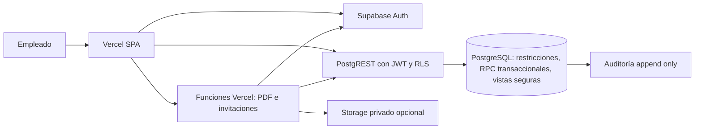

# Arquitectura técnica

## Decisión de frontend

| Criterio | React + Vite (A) | Next.js App Router (B) |
|---|---|---|
| Pantallas privadas y navegación | SPA con shell persistente, rutas y consultas paginadas; sin costo de SSR | Rutas y streaming útiles, pero SSR aporta poco sin SEO |
| Auth | Supabase Auth cliente, sesión renovada, RLS en cada consulta | Cookies y `@supabase/ssr`; más superficies de sesión/servidor |
| PDF, invitaciones, transacciones | Una o dos funciones Vercel; transacción SQL en PostgreSQL | Route Handlers/Server Actions integrados |
| Costo/mantenimiento | Static hosting más funciones puntuales | Runtime y caché más complejos; riesgo de mezclar reglas entre cliente/servidor |
| Codex | Límites de módulo y consultas explícitos | Más convenciones y modos de renderizado que revisar |

**Elegida A.** La aplicación es administrativa y privada. Vite reduce complejidad y permite navegación rápida tras cargar el shell. El PDF y las invitaciones justifican funciones Vercel puntuales; no justifican SSR de todas las páginas. Si mediciones posteriores muestran que SSR resuelve un problema real, esta decisión puede revisarse. Next.js 16 sigue siendo opción válida, no un error técnico.

## Versiones y bibliotecas

Línea base verificada en documentación oficial el 26/10/2026: React 19.3, Vite 8.1, Tailwind CSS 4.3, TanStack Query 5, Next.js 16 como alternativa. Node 22 LTS con versión concreta fijada en `.nvmrc` al iniciar (Vite 8 exige 20.19+ o 22.12+). Para el resto no se fija patch ahora: en etapa 1 comprobar `peerDependencies`, release estable y ejecutar instalación/compatibilidad antes de generar lockfile. Registrar versiones exactas en ADR y lockfile; Renovate/Dependabot en PR.

- UI: Tailwind 4, componentes shadcn/ui copiados y revisados, React Router, iconos Lucide. Verificar compatibilidad de shadcn con Tailwind 4 en el scaffold.
- Estado remoto: `@supabase/supabase-js` y TanStack Query 5; claves de consulta por filtro/rol, invalidación tras mutación. Sin store global de datos comerciales.
- Formularios: React Hook Form + Zod (mismo esquema de entrada en cliente y función, sin confiar en validación cliente).
- Tablas: TanStack Table con paginación, filtro y orden **en servidor**; evitar traer toda la cartera.
- Gráficos: Recharts, carga diferida; tablas accesibles como detalle de referencia.
- PDF: `@react-pdf/renderer` en función Vercel Node para plantilla A4. Probar fuente Inter, saltos de página y 40 conceptos; si la fidelidad visual exige HTML/CSS, evaluar Chromium sólo después de medir límites/costo. Una única proyección pública de datos autorizados.
- Fechas/moneda: `date-fns`, `Intl.NumberFormat('es-AR')`; fechas de evento como `date`, instantes de auditoría como `timestamptz`; importes `numeric` en PostgreSQL y decimal string/`decimal.js` en TS, nunca `number` para suma crítica.
- Errores/monitoreo: límite de error React, errores tipados, logs estructurados en función, Sentry opcional según costo y consentimiento, Vercel logs/Supabase logs; nunca loguear tokens ni datos sensibles.
- Pruebas: Vitest + Testing Library, pgTAP/Supabase local, Playwright para E2E, chequeos SQL de permisos y concurrencia.

Fuentes oficiales: [React](https://react.dev/versions), [Vite 8.1](https://vite.dev/blog/announcing-vite8-1), [Vite Node](https://vite.dev/guide/), [Tailwind 4.3](https://tailwindcss.com/blog/tailwindcss-v4-3), [TanStack Query 5](https://tanstack.com/query/latest/docs/framework/react/guides/migrating-to-v5), [Next.js 16](https://nextjs.org/blog/next-16), [Supabase RLS](https://supabase.com/docs/guides/database/postgres/row-level-security).

## Capas y límites



- **Frontend**: navegación, formularios breves, accesibilidad, vista según permiso, consulta paginada, estados vacío/carga/error. No decide autorización ni calcula saldos definitivos.
- **Base**: FK, unicidad, checks, RLS/GRANT, transiciones, aceptación atómica, auditoría, agregados de reportes y numeración comercial. Es la fuente única de verdad.
- **Funciones Vercel Node**: validar JWT en cada solicitud, PDF desde lectura autorizada y lista blanca; invitación y gestión Auth con secreto sólo en servidor; límite de tamaño y rate limit razonable. No replicar lógica económica.
- **Storage privado**: únicamente si se decide conservar adjuntos/evidencia; rutas por entidad y políticas de acceso. PDF enviado, si requiere evidencia histórica, se conserva como snapshot inmutable ligado a revisión; descarga bajo demanda para borrador/versión vigente con `ETag`/hash y sin URL pública.
- **Externos**: Supabase, Vercel, GitHub. Email transaccional de Auth según configuración; no sumar servicios hasta necesidad demostrada.

## Flujos críticos

1. Login por invitación; cliente Supabase obtiene sesión; `profiles.active` se comprueba en RLS en cada petición. El menú es sólo conveniencia.
2. Alta cliente busca CUIT y nombre normalizado; índice único de CUIT y mecanismo de colisión de nombre/alias; en carrera, la DB rechaza duplicado y UI ofrece reutilizar.
3. Aceptación: RPC `accept_quote(id, expected_revision, evidence)` con bloqueo de fila, validación de estado, total/revisión, inserción única de venta y proyecto, auditoría y retorno existente si la misma petición se repite. Venta/proyecto no se insertan libremente por API.
   > **Actualización (código, commit `2c0dab2`):** se separó en dos pasos. `accept_quote` **sólo** marca el presupuesto `accepted` (registra `accepted_by` + evidencia); la venta y el proyecto los crea una RPC aparte, `confirm_sale(id, expected_revision)` (permiso `ventas.confirm`), con la misma garantía transaccional e idempotente. Manda el código.
4. Cobro/factura/costo: inserción con clave idempotente, validaciones, auditoría; correcciones mediante anulación y reemplazo, no edición silenciosa del importe.
5. Reportes: funciones/vistas `security_invoker` o RPC con autorización explícita, fechas/filtros definidos y una fila por venta base antes de agregar movimientos. La fila detalle y el KPI usan la misma consulta lógica.

## Carpetas propuestas

```text
src/app/                 rutas, providers, shell y error boundary
src/shared/              UI, formatos, cliente Supabase, tipos, utilidades
src/modules/{auth,clients,crm,fairs,quotes,sales,projects,reports,admin}/
  components/ pages/ queries/ forms/ schemas/ tests/
api/                     funciones Vercel PDF e invitación
supabase/migrations/     SQL versionado, RLS, GRANTs, RPC
supabase/tests/          pgTAP e integridad
supabase/seed.sql        sólo datos ficticios locales
src/e2e/                 Playwright
docs/                    decisiones y operación
```

Módulos dependen de contratos de dominio y consultas compartidas, no de componentes internos ajenos. Evitar microservicios, Redis y colas. Añadir índices y paginación antes de cachés nuevas.

## Rendimiento objetivo y medición

Con 10–30 usuarios simultáneos y volúmenes iniciales supuestos de hasta 20 mil clientes, 100 mil movimientos y 5 años de datos: shell interactivo P75 < 2,5 s en conexión 4G normal; navegación de listado P75 < 1 s después del shell; consulta paginada P95 < 800 ms servidor; reporte trimestral P95 < 3 s; PDF de 1–40 conceptos P95 < 5 s. Son objetivos, no garantías de infraestructura: medir Web Vitals, trazas de red, `EXPLAIN ANALYZE` con datos representativos y logs Vercel/Supabase. Si no se alcanzan, corregir consultas/índices/bundle antes de sumar servicios.
