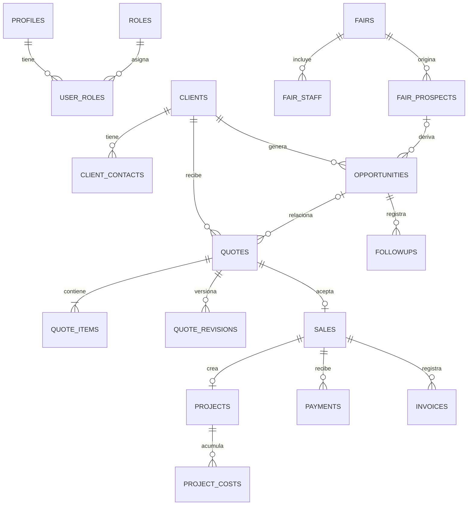

# Modelo de datos propuesto (PostgreSQL/Supabase)

Diseño lógico previo a migraciones. Todas las PK internas son `uuid default gen_random_uuid()`, FK explícitas, `created_at timestamptz not null default now()`, `created_by uuid references auth.users(id)` donde hay entrada humana, `updated_at timestamptz` para entidades editables. `numeric(18,2)` para importes ARS del alcance inicial; cantidad `numeric(12,3)` y precio `numeric(18,2)`, subtotal redondeado a dos decimales por fila con regla única DB. `currency char(3)` se fija inicialmente a `ARS` mediante check para evitar mezclar monedas; la decisión ARS/USD se valida antes de permitir otra moneda. No se calculan impuestos ni tipo de cambio sin regla aprobada. `date` para fecha comercial/evento y `timestamptz` para instantes; zona de presentación Argentina.

## Tablas y columnas

| Tabla | Columnas propias principales | Claves y reglas |
|---|---|---|
| `profiles` | `id uuid`, `display_name text`, `email text`, `active boolean`, `last_seen_at timestamptz` | `id` FK `auth.users`; email Auth es fuente; active falso niega acceso incluso con JWT vigente |
| `roles` | `code text`, `label text` | PK `code`; seed fijo (`direction`, `administration`, `seller`, `execution`, `support`) |
| `user_roles` | `user_id uuid`, `role_code text`, `granted_by uuid`, `granted_at timestamptz` | PK compuesta; permite varios roles; sólo función administrativa cambia |
| `clients` | `legal_name text`, `name_key text`, `tax_id text null`, `phone text`, `email text null`, `address text null`, `industry text null`, `notes text null`, `owner_id uuid`, `status text`, `merged_into_id uuid null` | CUIT normalizado único parcial cuando existe; `name_key` único entre activos con revisión de homónimos; `status` active/merged/archived; merge conserva FK |
| `client_contacts` | `client_id uuid`, `name text`, `phone text`, `email text`, `is_primary boolean` | v1 sólo principal; índice único parcial por `client_id where is_primary`; se separa para futura ampliación sin pantalla de contactos múltiples |
| `fairs` | `name text`, `place text null`, `starts_on date`, `ends_on date null`, `description text null`, `status text` | `ends_on >= starts_on`; active/cancelled |
| `fair_staff` | `fair_id uuid`, `user_id uuid` | PK compuesta; participantes vendedores, no define propiedad de cada prospecto |
| `fair_prospects` | `fair_id uuid`, `client_id uuid null`, `company_name text`, `name_key text`, `contact_name text null`, `phone text null`, `email text null`, `owner_id uuid`, `notes text null`, `first_seen_on date`, `status text` | único `(fair_id,name_key)` entre no anulados; empresa puede no ser cliente; vincular cliente tras búsqueda/merge |
| `opportunities` | `client_id uuid null`, `prospect_id uuid null`, `origin_fair_id uuid null`, `title text`, `owner_id uuid`, `stage text`, `estimated_amount numeric(18,2) null`, `next_followup_on date null`, `closed_at timestamptz null` | exactamente una referencia comercial inicial (`client_id` o `prospect_id`); feria heredada, no calculada de nombre; etapas new/sent/negotiation/won/lost |
| `followups` | `opportunity_id uuid null`, `prospect_id uuid null`, `occurred_at timestamptz`, `kind text`, `summary text`, `next_on date null`, `owner_id uuid` | al menos un destino; no duplicar actividad del mismo evento; registros append only con anulación |
| `quotes` | `client_id uuid`, `opportunity_id uuid null`, `origin_fair_id uuid null`, `owner_id uuid`, `commercial_no text unique`, `revision int`, `title text`, `event_on date null`, `issued_on date null`, `valid_until date null`, `status text`, `currency char(3)`, `estimated_cost numeric(18,2) null`, `total numeric(18,2)`, `public_notes text null`, `internal_notes text null`, `sent_at timestamptz null`, `accepted_at timestamptz null`, `acceptance_evidence text null` | draft/sent/accepted/rejected/void; `revision >= 1`; total DB = filas; enviado/conversión conserva snapshot; accepted sólo RPC |
| `quote_items` | `quote_id uuid`, `position int`, `description text`, `quantity numeric(12,3)`, `unit_price numeric(18,2)`, `subtotal numeric(18,2)` | único `(quote_id,position)`; quantity > 0, unit_price >= 0; subtotal calculado por DB o validado trigger |
| `quote_revisions` | `quote_id uuid`, `revision int`, `snapshot jsonb`, `sha256 text`, `created_at timestamptz` | único `(quote_id,revision)`; inmutable; snapshot público + interno protegido; se usa para reconstruir aceptación/PDF emitido |
| `sales` | `quote_id uuid unique`, `quote_revision int`, `client_id uuid`, `owner_id uuid`, `origin_fair_id uuid null`, `commercial_no text unique`, `accepted_on date`, `amount numeric(18,2)`, `currency char(3)`, `status text` | una venta por presupuesto; importe/cliente copiados transaccionalmente del snapshot aceptado, luego inmutables salvo anulación autorizada |
| `payments` | `sale_id uuid`, `amount numeric(18,2)`, `received_on date`, `method text`, `reference text null`, `idempotency_key uuid unique`, `status text`, `voids_payment_id uuid null`, `reason text null` | positivo; posted/void; corrección crea reemplazo y conserva anterior; referencia externa duplicada advertida/unicidad configurable |
| `invoices` | `sale_id uuid`, `invoice_no text`, `issued_on date`, `amount numeric(18,2)`, `document_path text null`, `idempotency_key uuid unique`, `status text`, `voids_invoice_id uuid null`, `reason text null` | número único activo según emisor/tipo pendiente de definir; no genera cobro |
| `projects` | `sale_id uuid unique`, `manager_id uuid null`, `event_on date null`, `status text`, `costs_complete_at timestamptz null`, `costs_complete_by uuid null`, `costs_reopened_at timestamptz null` | pending/in_progress/finished; finalizado y costos completos son hechos distintos |
| `project_costs` | `project_id uuid`, `amount numeric(18,2)`, `incurred_on date`, `description text`, `category text null`, `idempotency_key uuid unique`, `status text`, `voids_cost_id uuid null`, `reason text null` | positivo; posted/void; no FK a venta |
| `audit_events` | `entity_type text`, `entity_id uuid`, `action text`, `actor_id uuid null`, `occurred_at timestamptz`, `request_id uuid`, `before_data jsonb null`, `after_data jsonb null`, `reason text null` | append only; acceso lectura dirección/soporte autorizado; nadie desde cliente modifica |
| `app_settings` | `key text`, `value jsonb`, `updated_by uuid` | sólo claves permitidas: identidad PDF, datos de contacto, numeración/plantilla si aplica; secretos fuera de tabla |
| `support_access` | `support_user_id uuid`, `approved_by uuid`, `reason text`, `starts_at timestamptz`, `expires_at timestamptz`, `scope text` | concesión temporal doble control para soporte, auditada |

Para ventas/facturas/costos se prohíben `DELETE` físicos; anulación conserva importe original y motivo. Clientes/prospectos se fusionan con función específica, no borrado. Borrador de presupuesto puede archivarse; presupuestos enviados se versionan al corregir; aceptados no se editan. `quote_revisions` es historial, no segunda fuente de totales. Una venta anulada no cuenta en métricas ni deja visible su saldo, pero conserva pagos/facturas y exige conciliación/corrección por administración antes de anular. Costo completo se reabre automáticamente si se registra/corrige costo después del cierre.

## Integridad y operaciones

- FK de presupuesto a cliente; si deriva de oportunidad, validar mismo cliente y origen de feria; si oportunidad deriva de prospecto, vincular primero cliente sin perder `prospect_id`. `origin_fair_id` se fija al primer encuentro **atribuido**, con corrección sólo autorizada y auditada; `fair_prospects` registra cada encuentro. Regla exacta de “primera feria” pendiente de validación.
- Unicidad simultánea de cliente: `tax_id` normalizado cuando existe; `name_key` Unicode normalizado y único para activos, con flujo de revisión de falsos positivos. Prospecto: único por feria + empresa normalizada; teléfono/email ayudan a búsqueda, no se presumen identificadores globales perfectos.
- `accept_quote` bloquea presupuesto `FOR UPDATE`, comprueba revisión/estado, inserta venta (`unique quote_id`) y proyecto (`unique sale_id`) y registra auditoría en la misma transacción. Repetición devuelve IDs existentes sólo si misma revisión; solicitud contradictoria falla. Una excepción revierte todo.
  > **Actualización (código, commit `2c0dab2`):** hoy `accept_quote` **sólo** marca el presupuesto `accepted` (+ `accepted_by`/evidencia). La inserción de venta (`unique quote_id`, con `confirmed_by`/`confirmed_at`) y proyecto (`unique sale_id`) la hace `confirm_sale`, conservando bloqueo `FOR UPDATE`, idempotencia por revisión y auditoría. Además existen plantillas (`quote_templates`/`quote_template_items`) y `duplicate_quote`.
- `register_payment`, `register_invoice`, `register_cost`: `idempotency_key` generado por solicitud; restricción unique y comprobación de contenido para evitar reintentos dobles. Validar `amount > 0`; sobrecobro/sobrefacturación se bloquea inicialmente salvo autorización explícita pendiente. Saldos negativos nunca se silencian.
- Importes agregados: `paid = sum(payments posted)`, `invoiced = sum(invoices posted)`, `cost = sum(project_costs posted)`; saldos = venta activa - suma correspondiente. Margen estimado = `(venta - costo_estimado)/venta`; provisional = `(venta - costo_registrado)/venta`; definitivo sólo `costs_complete_at` no nulo. Si venta = 0 o costo faltante, `null`/“sin base”, jamás cero inventado. Ganancia y margen de reportes se agregan sobre **el mismo conjunto de ventas**; margen ponderado = suma ganancias / suma ventas.
- Numeración legible `P-AAAA-NNNN`, `V-AAAA-NNNN`, `PRY-AAAA-NNNN` mediante tabla `document_sequences(kind,year,next_no)` y función con bloqueo; huecos posibles, no es número fiscal. UUID es identidad estable.

## Índices iniciales

`clients(tax_id)` único parcial, `clients(name_key)` único parcial, `clients(owner_id,status)`, búsqueda trigram de nombre/contacto si volumen lo justifica; `fair_prospects(fair_id,name_key)` único parcial, `(owner_id,status)`, `(client_id)`; `opportunities(owner_id,stage,next_followup_on)`, `(origin_fair_id)`; `quotes(client_id,created_at desc)`, `(owner_id,status,issued_on)`, `(opportunity_id)`, `(origin_fair_id)`; `sales(accepted_on,owner_id)`, `(origin_fair_id)`; `payments(sale_id,status,received_on)`, `invoices(sale_id,status,issued_on)`, `projects(manager_id,status,event_on)`, `project_costs(project_id,status,incurred_on)`, `audit_events(entity_type,entity_id,occurred_at desc)`. FK no indexadas se revisan en migración. `EXPLAIN ANALYZE` decidirá adicionales, evitando índices de bajo uso.

## ERD

Migraciones SQL en `supabase/migrations`, seeds ficticios locales en `supabase/seed.sql`, pruebas pgTAP. Antes de publicar, probar reset **sólo local**, migración incremental con copia de staging y compatibilidad de código viejo/nuevo. No copiar personas/importes de muestra como datos reales.
