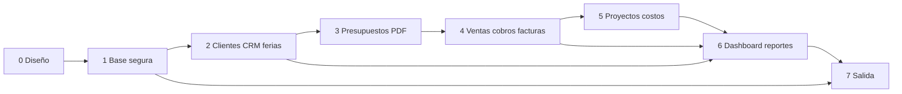

# Roadmap y estimaciones

## Supuestos

Horas de trabajo humano asistido por Codex: análisis, prompts, integración, revisión y pruebas incluidos; no son horas de máquina ni precio comercial. Una persona técnica senior responsable, revisión humana adicional puntual de seguridad/negocio, diseñador usando la propuesta vigente, 10–30 usuarios y sin importación masiva ni integraciones. El rango incorpora incertidumbre de decisiones pendientes y retrabajo moderado. Si se exige migración histórica, multi moneda/impuestos, aprobación jerárquica o adjuntos complejos, reestimar. Desarrollo y pruebas ocurren en cada etapa; etapa 7 agrega auditoría transversal. Las horas por categoría son rangos independientes; el total es suma de extremos.

| Etapa | Módulos | Dependencias | Desarrollo h | Revisión h | Pruebas h | Total h | Tareas | Complejidad/riesgo | Entregable y aprobación |
|---|---|---|---:|---:|---:|---:|---:|---|---|
| 0 Auditoría/diseño | Fuentes, ADR, modelo, RLS, backlog | Ninguna | 24–36 | 12–18 | 4–8 | 40–62 | 5 | Alta: reglas no acordadas | Diseño revisado, decisiones con dueño y fecha |
| 1 Base segura | Repo, UI, Auth, roles, migraciones, CI, Preview | 0 | 55–85 | 16–26 | 24–38 | 95–149 | 6 | Alta: Auth/RLS/entornos | Login invitado; matriz de denegaciones automatizada; Preview aislado |
| 2 Clientes/CRM/ferias | Alta, ficha, pipeline, prospectos, seguimientos | 1 | 75–115 | 18–28 | 32–50 | 125–193 | 9 | Media: duplicados/origen | Demo persistente con V y D, enlaces correctos y tests de carrera |
| 3 Presupuestos/PDF | Ítems, estados, costo interno, PDF A4 | 2 clientes; CRM opcional | 65–100 | 16–26 | 28–44 | 109–170 | 5 | Alta: versión/PDF/ocultación | V emite PDF real; 40 ítems y permisos verificados |
| 4 Ventas/cobros/facturas | Aceptación, saldo, facturado | 3 | 70–110 | 20–32 | 38–60 | 128–202 | 6 | Muy alta: concurrencia/economía | Venta+proyecto únicos, movimientos y saldos conciliados |
| 5 Proyectos/costos | Estados, costos, completitud, margen | 4 | 45–75 | 12–20 | 24–38 | 81–133 | 5 | Alta: margen definitivo | Proyecto operativo y comparación estimado/real consistente |
| 6 Dashboard/reportes | Negocio, vendedores, ferias, rentabilidad | 2–5 | 70–110 | 18–30 | 32–52 | 120–192 | 6 | Alta: atribución/doble conteo | KPIs igualan detalles con filtros y roles |
| 7 Salida | Auditoría, rendimiento, backup, UAT, formación | 1–6 | 30–50 | 18–30 | 35–55 | 83–135 | 3 | Alta: operación real | Checklist firmado, restauración probada, producción estable |
| **Total** | | | **434–681** | **130–210** | **217–345** | **781–1236** | **45** | | |

El MVP operativo termina al final de etapa 5: **578–909 h** incluyendo etapa 0. El sistema completo: **781–1236 h**. Primer demo útil al final de etapa 2: **260–404 h**. Son estimaciones de construcción profesional con IA y revisión, no compromiso contractual; la amplitud refleja incertidumbre real de reglas y adopción. Un equipo de dos podría acortar calendario, no reducir estas horas en proporción.

## Dependencias y camino crítico

Camino crítico: decisiones de identidad/permisos → esquema/RLS → cliente → presupuesto/versionado → aceptación/venta/proyecto → costos/completitud → rentabilidad y reportes → UAT. En paralelo sin colisión: UI de clientes y feria tras contratos de tablas; plantilla PDF con datos ficticios mientras se construye editor (integración posterior); pruebas de permisos junto a migraciones; diseño de consultas de reportes tras reglas económicas, aunque la UI se construya después. Evitar ramas simultáneas que modifiquen la misma migración o contratos de `quotes`.

## Puertas por etapa

- 0: Arpeco valida flujo mínimo y matriz de acceso; dudas restantes tienen recomendación y plazo.
- 1: roles reales invitados; anon denegado; V no puede cambiar owner ni ver tablas sensibles; CI y Preview apuntan a staging.
- 2: búsqueda reutiliza cliente, colisiones concurrentes controladas, feria no obliga alta de cliente, oportunidad y seguimiento persisten; prueba E2E con dos roles.
- 3: borrador/enviado/aceptado tienen transición; revisiones reproducibles; PDF sólo público, descarga autorizada y continuidad visual.
- 4: dos aceptaciones simultáneas crean una venta/proyecto; fallo revierte; cobro/factura independientes; anulación trazada y saldo correcto.
- 5: costo pertenece al proyecto, estado y cierre de costos separados; margen no se llama real hasta cierre; reapertura si cambia un costo.
- 6: cada KPI tiene consulta, fecha y filtro declarados; detalle concilia; V sólo individual; carga y tiempos medidos.
- 7: amenazas revisadas, restore ejercitado, UAT por rol, capacitación/manuales, rollback viable y lista go live aprobada.

Mejoras posteriores no comprometidas: stock/materiales, múltiples contactos con UI, tareas de producción, integraciones de facturación, recordatorios, presupuestos multi moneda, comisiones y objetivos.
